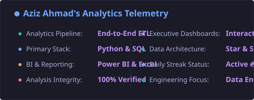
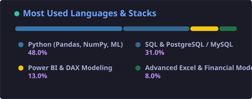
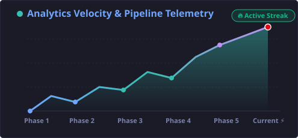
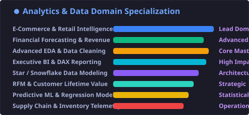

<div align="center">

# 👨‍💻 Hi there, I'm Aziz Ahmad ([@azizahmad-khan](https://github.com/azizahmad-khan)) 🚀

<p align="center">
  <a href="https://github.com/azizahmad-khan">
    
  </a>
</p>

<p align="center">
  
  
  
  
</p>

---

</div>

## 🚀 About Me

BS Computer Science student and Data Analyst specializing in exploratory data analysis, business intelligence, data warehousing, and predictive modeling — building end-to-end data pipelines and actionable executive dashboards using **Python, SQL, PostgreSQL, Power BI, and Advanced Excel**.

```yaml
Name: Aziz Ahmad Khan
Handle: azizahmad-khan
Degree: BS Computer Science
Specialization: Data Analytics, Business Intelligence & Data Engineering
Core_Stack: Python, SQL, PostgreSQL, Power BI, Excel, Pandas, Scikit-Learn
Focus: Dimensional Modeling (Star/Snowflake), Exploratory Data Analysis, KPI Dashboards & Predictive Modeling
Mindset: "Turn complex data into decisive insights — Discover → Cleanse → Analyze → Visualize → Impact."
```

---

## ⚡ GitHub Streak & Real-Time Stats

<div align="center">

<a href="https://github.com/azizahmad-khan">
  
</a>

<br/><br/>

<p align="center">
  <a href="https://github.com/azizahmad-khan">
    
  </a>
  <a href="https://github.com/azizahmad-khan?tab=repositories">
    
  </a>
  <a href="https://github.com/azizahmad-khan">
    
  </a>
  <a href="https://github.com/azizahmad-khan">
    
  </a>
</p>

<br/>

<a href="https://github.com/azizahmad-khan">
  
  
</a>

<br/><br/>

<a href="https://github.com/azizahmad-khan">
  
  
</a>

</div>

---

## 🛠️ Tech Stack & Toolbelt

<div align="center">

### 💻 Languages & Query Engines
<a href="https://www.python.org/" target="_blank"></a>
<a href="https://www.postgresql.org/docs/" target="_blank"></a>
<a href="https://isocpp.org/" target="_blank"></a>
<a href="https://developer.mozilla.org/en-US/docs/Web/JavaScript" target="_blank"></a>

### 🧠 Data Analytics, BI & Machine Learning
<a href="https://powerbi.microsoft.com/" target="_blank"></a>
<a href="https://www.microsoft.com/en-us/microsoft-365/excel" target="_blank"></a>
<a href="https://pandas.pydata.org/" target="_blank"></a>
<a href="https://numpy.org/" target="_blank"></a>
<a href="https://scikit-learn.org/" target="_blank"></a>
<a href="https://matplotlib.org/" target="_blank"></a>
<a href="https://seaborn.pydata.org/" target="_blank"></a>

### 🗄️ Databases & Storage Engines
<a href="https://www.postgresql.org/" target="_blank"></a>
<a href="https://www.mysql.com/" target="_blank"></a>
<a href="https://www.sqlite.org/" target="_blank"></a>
<a href="https://www.mongodb.com/" target="_blank"></a>

### ⚙️ Engineering, Automation & Environments
<a href="https://jupyter.org/" target="_blank"></a>
<a href="https://code.visualstudio.com/" target="_blank"></a>
<a href="https://git-scm.com/" target="_blank"></a>
<a href="https://github.com/features/actions" target="_blank"></a>
<a href="https://www.docker.com/" target="_blank"></a>

</div>

---

## 🏛️ Enterprise Data & Analytics Architecture

```mermaid
flowchart LR
    subgraph S1 ["1. Data Ingestion & Extraction"]
        I1["🛒 E-Commerce & POS Feeds"]
        I2["📄 CSV / Excel / JSON Datasets"]
        I3["📡 REST APIs & Web Scrapers"]
    end

    subgraph S2 ["2. Lakehouse & Dimensional DW"]
        D1[("PostgreSQL 16 Enterprise")]
        D2["🧹 Data Cleansing & Normalization"]
        D3["📐 Star & Snowflake Schemas"]
    end

    subgraph S3 ["3. Analytics & Predictive Modeling"]
        M1["⚡ Aggregations & Window Functions"]
        M2["👥 Cohort & RFM Customer Segmentation"]
        M3["📈 Predictive ML & Trend Forecasting"]
    end

    subgraph S4 ["4. Executive BI Delivery"]
        E1["📊 Interactive Power BI Dashboards"]
        E2["📑 Automated Performance Reports"]
        E3["🎯 Data-Driven Decision Support"]
    end

    S1 --> S2 --> S3 --> S4

    style S1 fill:#131d31,stroke:#3b82f6,stroke-width:1.5px,color:#fff
    style S2 fill:#0f2b24,stroke:#10b981,stroke-width:1.5px,color:#fff
    style S3 fill:#271b38,stroke:#8b5cf6,stroke-width:1.5px,color:#fff
    style S4 fill:#2d1e15,stroke:#f59e0b,stroke-width:1.5px,color:#fff
```



---

## 🌟 Curated Enterprise Data Analyst & BI Portfolio

### 1️⃣ E-Commerce, Retail & Growth Analytics
| Project | Domain Focus | Key Architecture & Analytics | Deliverable |
| :--- | :--- | :--- | :---: |
| 🛍️ **[E-Commerce-Sales-Analysis](https://github.com/azizahmad-khan/E-Commerce-Sales-Analysis)** | E-Commerce Sales & Revenue Intelligence | Exploratory data analysis of customer transaction streams, uncovering revenue trends, top-performing SKUs, seasonal seasonality, and purchasing patterns. | 📓 Jupyter & Visual Reports |
| 👥 **Customer-Churn-Prediction-Engine** | Retention & Churn Hazard Modeling | RFM (Recency, Frequency, Monetary) segmentation, logistic regression & random forest churn scoring with automated cohort retention curves. | 📊 Predictive Models |
| 🏷️ **Dynamic-Retail-Pricing-Optimizer** | Merchandising & Markdown Optimization | Price elasticity of demand, promotion markdown optimization, and gross margin return on inventory investment (GMROI). | 📈 Analytics Dashboard |

---

### 2️⃣ Financial Intelligence & Business Performance
| Project | Domain Focus | Key Architecture & Analytics | Deliverable |
| :--- | :--- | :--- | :--- |
| 💳 **Financial-Cashflow-Forecasting-Model** | Corporate Finance & Working Capital | Time-series ARIMA / Prophet models projecting cash flow runway, identifying expense anomalies, and balance sheet reconciliation. | 📊 Power BI Executive Model |
| 🏦 **Loan-Risk-Credit-Scoring-System** | Credit Risk & Portfolio Delinquency | Multi-tier borrower scoring model, probability of default (PD), loss given default (LGD), and bad debt minimization. | 🛡️ Risk Assessment Suite |

---

### 3️⃣ Healthcare & Operational Analytics
| Project | Domain Focus | Key Architecture & Analytics | Deliverable |
| :--- | :--- | :--- | :--- |
| 🏥 **Hospital-Patient-Flow-Analytics** | Clinical Throughput & Bed Occupancy | Bed occupancy surge analysis, emergency room door-to-treatment triage latency, and 30-day patient readmission reduction models. | ☀️ Operations Dashboard |
| 💊 **Pharmacy-Supply-Chain-Optimization** | Medication Inventory & Lead Times | Safety stock calculation using EOQ formulas, stockout penalty reduction, and expiration date waste minimization. | 📦 Supply Optimization |

---

### 4️⃣ Supply Chain & Logistics Telemetry
| Project | Domain Focus | Key Architecture & Analytics | Deliverable |
| :--- | :--- | :--- | :--- |
| 🚢 **Global-Logistics-Route-Efficiency** | Fleet Routing & Freight Telemetry | On-Time In-Full (OTIF) compliance monitoring, corridor transit time variability, and fuel consumption optimization. | 🗺️ Fleet Intelligence Suite |
| 🏭 **Warehouse-Inventory-Velocity-Tracker** | Distribution Center Fulfillment | Pick-and-pack fulfillment latency, fast-moving vs slow-moving SKU clustering, and spatial storage utilization. | 📊 Power BI Analytics Suite |

---

## 💼 Core Competencies

- **📊 Exploratory Data Analysis & Statistical Inference**: Advanced distribution profiling, hypothesis testing, correlation matrices, outlier handling, and statistical modeling.
- **📐 Enterprise Data Warehousing & Dimensional Modeling**: Star and Snowflake schema design, fact and dimension table engineering, SCD tracking, and PostgreSQL query optimization.
- **📈 Interactive Power BI Dashboards & Executive Storytelling**: Dynamic DAX measures, KPI cards, drill-through hierarchies, and clear, business-driven visual narratives.
- **⚙️ High-Performance SQL Optimization & ETL Pipelines**: Complex multi-table joins, subqueries, CTEs, window functions (`PARTITION BY`, `ROW_NUMBER`), and automated data pipelines.

---

## 🌐 Connect With Me

<p align="left">
<a href="https://www.linkedin.com/in/aziz-ahmad-663a63348/" target="_blank">
  
</a>
<a href="https://github.com/azizahmad-khan" target="_blank">
  
</a>
<a href="mailto:rosecol0987@gmail.com">
  
</a>
</p>

---

<div align="center">

### 🚀 *"Consistency is what transforms average into excellence. Daily commits, continuous learning."*

⭐ **If you find my repositories helpful, feel free to drop a star!** ⭐

</div>
